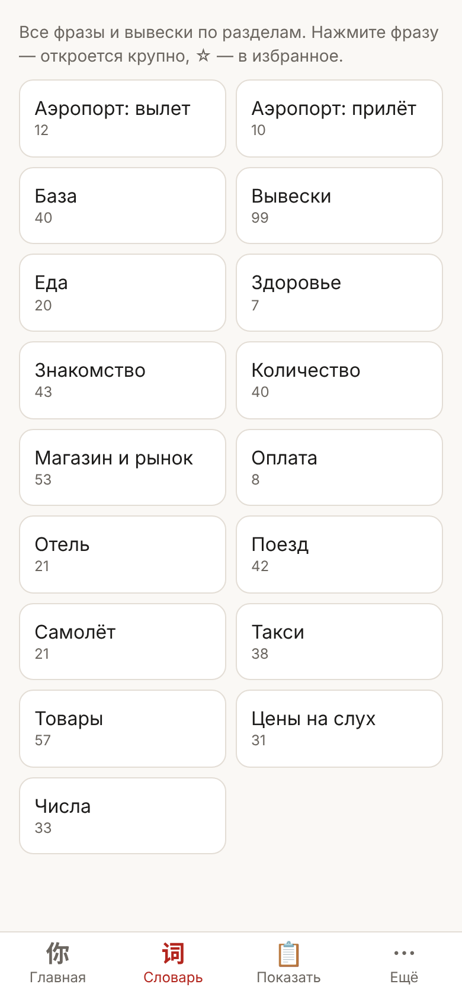
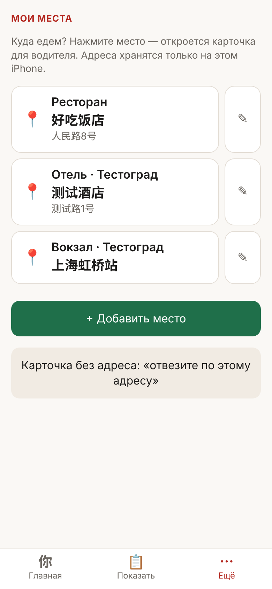

# Китайский для туриста — офлайн-разговорник и тренажёр

[](https://github.com/aleksandrkaiser/china-travel-companion/actions/workflows/check.yml)
[](LICENSE)

Бесплатное приложение для русскоязычного туриста в Китае: фразы с иероглифами, pinyin и **произношением кириллицей «как слышится»**, карточки «показать таксисту» со своими адресами, справочник о жизни в Китае и уроки. Работает **без интернета** — ставится на экран «Домой» iPhone как обычное приложение.

**▶ Открыть: [aleksandrkaiser.github.io/china-travel-companion](https://aleksandrkaiser.github.io/china-travel-companion/)**

<p>





</p>

## Что внутри

| | |
|---|---|
| **Главная** | Поиск сразу по всему, свои кнопки (по умолчанию «Такси», «Не говорю», «Помощь»; любая фраза или место — кнопкой 📌), избранное (＋ — добавить) и недавние с подсказками. Блоки и кнопки настраиваются |
| **Словарь** | 458 фраз в 16 разделах по алфавиту (база, знакомство, такси, отель, поезд с вокзалами, еда, магазин, числа, цены на слух, оплата, здоровье…) и 99 вывесок; поиск внутри раздела, ☆ — в избранное |
| **Показать** | Ваше избранное ☆ крупными карточками для собеседника. Листаются свайпом, увеличиваются, поворачиваются; экран не гаснет |
| **Уроки** | 12 уроков по ситуациям поездки: тоны, приветствия, знакомство, числа и время, цены на слух, счётные слова, магазин и торг, такси, поезд и еда в поезде, отель, еда и оплата, вежливость. Грамматика — внутри ситуаций. 119 упражнений: выбор, сборка фразы, тон на слух, цены на слух |
| **Справка** | 12 статей «Жизнь в Китае»: въезд, Alipay, DiDi, метро, поезда, пауэрбанки в самолёте, связь, розетки, экстренные номера, этикет. У каждого факта — источник и дата проверки |
| **Карточки** | Листайте колоду в случайном порядке: иероглифы и pinyin, нажатие — кириллица и перевод; «Назад» — к прошлой карточке; знакомые — «Знаю — не показывать» |
| **Мои фразы** | Нет нужной фразы — кнопка «Спросить Claude» готовит запрос для приложения Claude; ответ вставляется в тренажёр и дальше работает офлайн |
| **Мои места** | Свои адреса иероглифами (отель, вокзал, ресторан). «Такси» → выбрал место → карточка для водителя; нет адреса — «Покажу на карте». Хранятся только на устройстве |
| **Слоги** | Все 406 слогов путунхуа с кириллицей |
| **Помощь и FAQ** | Вводный гайд, «Что нового», жесты, нет звука, почему всегда голос Tingting, обновление и сброс данных |

## Установка на iPhone

1. Откройте [ссылку](https://aleksandrkaiser.github.io/china-travel-companion/) в **Safari**.
2. «Поделиться» → «На экран „Домой“».
3. Откройте приложение с иконки один раз при интернете — всё скачается для офлайна.

На Android: Chrome → меню → «Добавить на главный экран».

Для озвучки нужен китайский голос iOS — скачайте его в настройках универсального доступа (раздел про озвучивание текста, голоса → китайский). В беззвучном режиме iPhone озвучка молчит — это ограничение Safari. Safari даёт веб-приложениям только часть голосов iOS, поэтому часто звучит Tingting, даже если в настройках выбран другой голос; выбор доступных голосов и скорости — «Ещё → Настройки → Голос».

## Как пользоваться

- **Главная** — поиск по всему сразу: по-русски, pinyin (тоны можно не ставить), кириллицей или иероглифами. Не нашлось — «Спросить Claude». Ниже — избранное и недавние фразы. Все разделы — вкладка «Словарь». Справка, уроки и карточки — в «Ещё».
- **Жесты как в iOS** — свайп от левого края экрана — назад; свайп по строке влево — «Удалить» (избранное, недавние, мои места). Двойной тап страницу не увеличивает.
- **Нажмите любую фразу** — откроется крупно для собеседника. ☆ — в избранное (избранное появляется в «Показать» и отдельной колодой карточек).
- **Адреса** — «Такси» на главной или «Ещё → Мои места»: впишите название и адрес иероглифами (из подтверждения брони или карты). Место открывается карточкой для водителя.
- **Обновления** приходят сами при интернете — появится кнопка «Обновить».
- **Резервная копия** — «Ещё → Настройки»: прогресс, избранное, мои места и мои фразы сохраняются в файл и восстанавливаются из него.

Всё, что вы вводите, хранится только на вашем устройстве. Сервера нет.

## Произношение кириллицей

Не система Палладия, а запись «как слышится» — чтобы прочитать фразу вслух без подготовки:

| pinyin | кириллица | пример |
|---|---|---|
| zh / ch / sh / r | дж / ч / ш / ж | zhōngwén → джонг-вэн |
| j / q / x | дз / ч / с + мягкая гласная | xièxie → сье-сье |
| -ng | нг (носовое, «г» не выговаривается) | máng → манг |
| -ian, -iu | ьен, ёу | diàn → дьен, jiǔ → дзёу |
| ü | юй | nǚ → нюй |
| -i после zh ch sh r z c s | ы | shì → шы |

Тон по кириллице не передаётся — смотрите на pinyin. Полные правила — в [src/README.md](src/README.md).

## Для разработчиков

Одна страница без фреймворков и сервера: данные вшиты в `index.html`, офлайн обеспечивает service worker с кэшем. Контент описан на Python, кириллица генерируется автоматически.

```
src/data.py       фразы, вывески, карточки        src/build.sh      сборка + проверки
src/lessons.py    уроки и упражнения              src/check.py      проверки данных и сборки
src/guide.py      справочник с источниками         src/e2e.py        сквозной тест в Chromium
src/translit.py   pinyin → кириллица
src/pwa_template.html  интерфейс
```

```sh
sh src/build.sh            # пересобрать приложение → «ИТОГ: OK»
python3 src/e2e.py         # главная, места, все уроки, офлайн и обновление
python3 src/e2e.py --shots # то же + скриншоты в docs/screenshots/
```

Нужны: Python 3, Node.js (проверка синтаксиса JS), `playwright` для тестов. На каждый push GitHub Actions пересобирает проект и прогоняет тесты.

Хотите разговорник для другой страны — сделайте форк и замените данные в `src/*.py`: интерфейс от языка почти не зависит (кроме транскрипции).

## Источники и точность

Факты в справочнике сверены с официальными источниками на дату, указанную в каждой статье; непроверенное помечено [из памяти]. Правила (въезд, пауэрбанки, оплата) меняются — перед поездкой сверяйтесь с источниками по ссылкам.

## Лицензия

[MIT](LICENSE) — можно свободно использовать, менять и распространять, в том числе в своих проектах.
